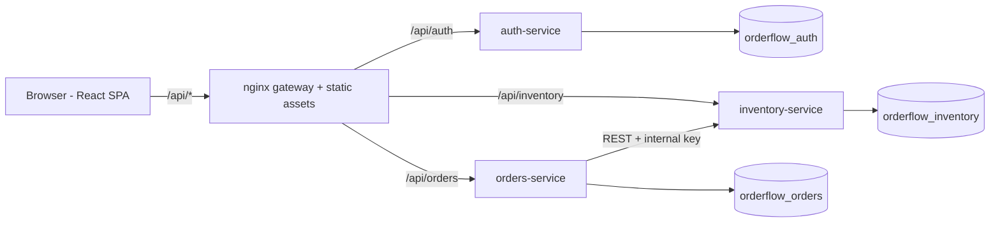

# Architecture

All three databases live on one PostgreSQL instance locally and on one RDS instance in AWS, but each service has its own database and never queries another service's tables. Splitting them onto separate instances later requires no code change.

## Key design decisions

**JWT auth, stateless services.** The auth service signs a short-lived JWT (`sub`, `email`, `role`). Inventory and orders verify it locally with the shared secret, so there is no per-request call to auth. Trade-off: tokens cannot be revoked before expiry; mitigations are the 1-hour lifetime and, as a next step, refresh tokens + a denylist or asymmetric keys (RS256 with a JWKS endpoint so only auth holds the private key).

**Order creation is a saga with compensation.** Distributed transactions across two databases are impractical, so `POST /orders` (1) asks inventory to reserve stock atomically, then (2) writes the order in its own transaction. If (2) fails, orders calls inventory's `release` as a compensating action. Cancellation does the reverse and rolls the status back if the release fails. The remaining gap - a crash between steps 1 and 2 - would leak reserved stock; the production fix is a reservation record with a TTL (or the transactional outbox pattern + a message queue). This is the first thing to mention if asked "what would you improve?".

**No overselling under concurrency.** `reserve` locks the affected product rows with `SELECT ... FOR UPDATE` in a deterministic (sorted) order inside one transaction and validates all lines before decrementing any, so the operation is all-or-nothing and deadlock-free. A test fires 25 concurrent requests at 10 units of stock and asserts exactly 10 succeed.

**Server-authoritative pricing.** The client sends only product IDs and quantities. Prices and names come from inventory at reservation time and are snapshotted onto the order lines, so historical orders do not change when prices change, and clients cannot tamper with totals.

**Authorization.** Role-based (`admin`, `staff`). Staff see only their own orders; admins see all. Other users' order IDs return 404 rather than 403 to avoid leaking existence. Internal `reserve`/`release` endpoints need a shared `x-internal-key` and are additionally blocked at the nginx gateway and by a Kubernetes NetworkPolicy that only lets the orders pods reach inventory.

**Frontend state.** Server data (products, orders) is owned by RTK Query (caching, de-duplication, tag-based invalidation after mutations, so stock levels refresh after an order). Client-only state (session, cart) is in Redux Toolkit slices. The session token is kept in `sessionStorage` (cleared when the tab closes). Trade-off: any XSS could read it; the alternative is an HttpOnly, SameSite cookie issued by the gateway, which is the recommended hardening.

**Operability.** Structured JSON logs, `/health` endpoints used by Docker and Kubernetes probes, graceful shutdown on SIGTERM, HPA, resource limits, rolling updates with `maxUnavailable: 0`, non-root read-only containers, forward-only SQL migrations that run at start-up.

## Known limitations / good next steps

1. Replace in-process migration-on-start with a Kubernetes Job or init container (avoids races when several replicas start together).
2. Add OpenTelemetry tracing and Prometheus metrics; add a dashboard and alert.
3. Add contract tests between orders and inventory (e.g. Pact) and Playwright end-to-end tests in CI.
4. Reservation TTL / outbox for crash-safe stock handling; idempotency keys on `POST /orders`.
5. HTTPS + custom domain (ACM certificate on the ALB), WAF, and moving secrets to External Secrets Operator.
6. Refresh tokens / HttpOnly cookie sessions; password reset and email verification.
